# Using the Android app

How to pair the app with your server, set up a printer, and add spools by hand or from label photos. To install
the app first, see [Install the Android app](install-android-app.md); the server is
[Install the server](install-server.md).

The home screen has these buttons: **Add spool**, **Add profile**, **Search**, **Printers** and **Settings**. A
dot at the top shows the connection: green **Connected**, yellow **Connecting…** or **Needs local network
access**, red **Can't reach the server** or **The server's certificate changed**, grey **Not paired**.
The dot follows the server while the app is open, within about 20 seconds. **Add from label photos** is only there
when AI label reading is turned on at the server. The app is light or dark as your phone is set. The small line at
the bottom shows the app's version and the server's.

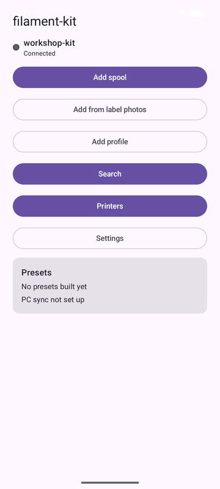

## 1. Pair the app with your server (once per phone)

1. On the server, in a Terminal:

   ```bash
   sudo filament-kit pair
   ```

   It prints a QR code, the server's certificate fingerprint and a 6-digit code, good for about 10 minutes. (The
   server's setup page, `https://<computer name>.local:8710/setup`, can show a pairing code too.)
2. Open the app. On Android 17 and newer, tap **Allow** when it asks for **local network access** (it may call it
   **Nearby devices**). Without it the
   app can't find or reach your server. If you said no, the app shows **Allow** again, and **Open app settings**
   once Android stops asking.
3. Tap **Scan QR code**, allow the camera, and point the phone at the code in the Terminal. Done: the home screen
   opens with a green **Connected**. **Keep the white border around the QR code**: scan it from the whole
   Terminal window, and don't crop it or zoom in so far that the border is cut off.

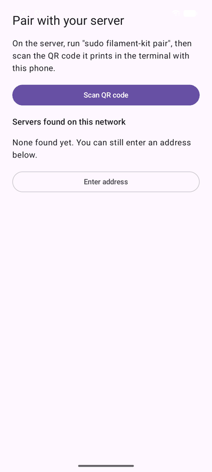

**No camera, or the code won't scan?** On **Pair with your server**:

1. Under **Servers found on this network**, tap your server: it goes straight to the fingerprint check. If it isn't
   listed, tap **Enter address** and type the computer's name with `.local` (for example `my-server.local`) or its IP
   address; leave **Port** at 8710, and tap **Connect**.
2. **Check the server's fingerprint** shows the server's address and its full fingerprint. Compare it with the
   fingerprint shown with the pairing code on the server (in the Terminal, or on the setup page). If they match, tap
   **It matches**. If they differ, tap **It does not match** and stop.
3. Type the **6-digit code** from the Terminal.

**If it fails:** the code works once and expires; run `sudo filament-kit pair` again for a new one. Other
problems are in [Install the Android app](install-android-app.md#common-problems).

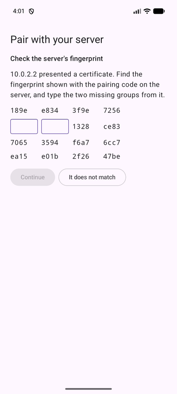

**Unpair or pair again.** On the phone: **Settings** shows the server's name, address and certificate fingerprint.
**Forget server** (it asks to confirm; the spools stay on the server) unpairs this phone, and then you pair again
as above. **Pair again** does it in one step. On the server, `sudo filament-kit unpair`
lists paired phones and `sudo filament-kit unpair <id>` removes one; that phone is then asked to pair again. If the
app shows **The server's certificate has changed**, it lists the new fingerprint, which you can compare with the one shown with a pairing code on the server. Tap
**Trust the new certificate** to keep this pairing, or **Pair again** to pair with a new code. If you didn't reinstall or move the server, another
device may be answering at that address, and trusting it gives that device this phone's access. If the server no
longer knows this phone, for example after a reinstall with `--purge`, the app asks you to pair again.

**Skip the fingerprint check for new servers**, on the first pairing screen and in **Settings**, is off by default. With it on, picking a server from
the list or typing its address goes straight to the 6-digit code and the app trusts the certificate the server presents. A scanned
QR code is checked either way, and a certificate that changes after pairing still asks you first.

**Licences and third-party software**, at the bottom of **Settings**, shows the app's licence (GPL-3.0-or-later) and the
third-party software list, and the full GPL text. It works offline.

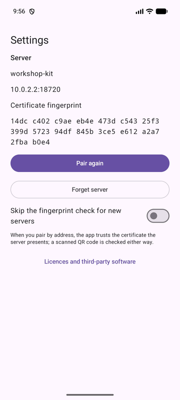 

## 2. Set up a printer

You need a Bambu Lab printer on the same network as the server, switched on.

1. Open **Printers**. The server finds printers by itself; each shows its name, model and state. If the list is
   empty, check the printer is on and tap **Refresh**.
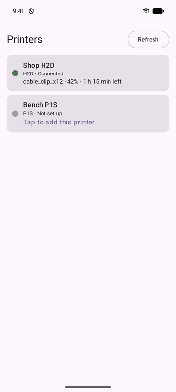 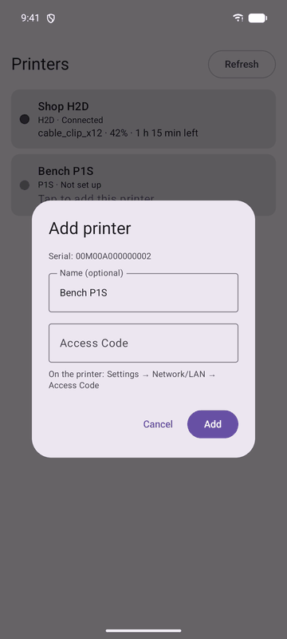

2. A printer marked **Tap to add this printer** is found but not set up. Tap it. The **Add printer** box shows its
   serial. Optionally give it a **Name**, type its **Access Code**, and tap **Add**. The code is on the printer:
   **Settings → Network/LAN → Access Code**.
3. The state turns to **Connected**, and tapping the printer opens its screen with live status, camera, the filament
   in each slot, pause/resume/stop and the chamber light. A loaded slot's colour sits inside a black ring, so white
   filament still shows; an empty slot is a dashed ring.

**If the state says something else:**

- **Wrong Access Code** (the row says **Tap to enter the Access Code again**): tap the printer, enter the code
  again.
- **Needs Developer Mode**: on the printer open **Settings → Network/LAN**, turn on **LAN Only mode** and then
  **Developer Mode**, and try again. Without it the printer refuses commands.
- **Offline**: check the printer is on and on the same network as the server.
- **Certificate changed**: the app explains it. If you reset the printer or replaced its mainboard, add it again
  with its Access Code; if not, check the printer's address first.
- The camera needs **LAN Mode Liveview** switched on in the same printer menu.

**Printer not in the list at all?** Add it from the server instead: `sudo filament-kit config` → **5) Printers** →
**add printer**, with its name, IP address, serial number and Access Code. (A server in WSL or a virtual machine
behind NAT can't see printers; see [Running the server in WSL](install-server.md#running-the-server-in-wsl).)

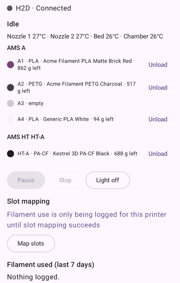

### Map slots: needed before filament use is taken off spools

Loading a spool into a slot works without it. Mapping teaches the server how the printer numbers its slots, so
that after a print the filament used is taken off the right spools. Until then, use is only logged on the
printer's screen under **Filament used (last 7 days)**.

Once a printer has been mapped, the server maps it again by itself when its AMS layout changes (you add or remove a
unit) and stays unchanged for 30 seconds, or after two prints in a row that disagreed with the map. It waits until
the printer is idle and tries up to 3 times, 10 minutes apart. The slot colours change briefly while it runs, without
you tapping anything. To switch this off, set `"auto_remap": false` in `/etc/filament-kit/config.json`.

1. Open the printer, make sure it's idle, and tap **Map slots**.
2. Read the box and tap **Map slots** again. The app briefly changes each slot's colour on the printer, one at a
   time, and runs a short job that doesn't heat or move anything; every slot is set back afterwards.
3. **Slots mapped (n)** means it worked. **Slots mapped: confirmed for the loaded slots** also works; map again once
   a second unit or an HT has a spool loaded, to settle the numbering. **Slot numbering not confirmed** or
   **Slot mapping failed** lists what the server reported; fix that and tap **Map slots again**. **Layout changed** or
   **Recent prints disagreed with the map** means a new mapping is due; it starts by itself when the printer is
   idle, or tap **Map slots again**. A result from an earlier server run is labelled as old: it may be fixed by now.

The **Map slots** button is greyed only while the printer is not connected or is printing, or while a mapping runs.
Until a mapping works, use is only logged, not taken off spools.

### Load and unload a spool

- **Load:** open a spool (by tapping its tag, or via **Search**) and tap **Load into printer**. Pick the
  printer, pick the slot, and tap **Load**. This sets the slot on the printer to match the spool and moves the
  spool to that slot in your inventory.
- **Unload:** open the printer and tap **Unload** next to the slot. Only the inventory changes; the printer's own
  slot setting stays as it is.

## 3. Add spools

### A. By hand

1. On the home screen tap **Add spool**.
2. Under **Find a filament in Spoolman**, type a few words (for example `sunlu petg`). Tap a match to start from a
   filament you already have, or tap **New filament** for one that's new.
3. Fill in the card (fields marked in red need attention):

   | Field | What to enter |
   |---|---|
   | **Vendor** | The brand. Tap **Pick** for ones you already use; picking one fills in its empty-spool weight. |
   | **Name** | The product and colour, for example `PETG Grey`. |
   | **Line** | The product line (every colour of a line shares presets). |
   | **Material** | `PLA`, `PETG`, `PLA+`, ... |
   | **Bambu Studio parent** | Which Bambu preset the filament's preset starts from. Leave blank to let the kit choose, or tap **Pick**. |
   | **Colour (hex)** | Six hex digits, for example `808080`. |
   | **Spools** | How many identical spools. |
   | **Net weight (g)** | The filament weight on the label, for example 1000. |
   | **Empty spool (g)** | The weight of the empty spool. |
   | **Density (g/cm³)** | Leave blank and it's filled in from the material when known. |
   | **Nozzle °C**, **Bed °C** | Optional. |
   | **Still sealed** | Tick for a spool still in its bag or box. |
   | **Weight with spool (g)** | For an opened spool: its weight on a scale; blank means full. |
   | **Location** | Where it lives; blank means the server picks. |

4. Tap **Preview**. Nothing is saved yet: the app shows what would be added. If a field is still missing it says
   `Spool 1 still needs: ...`.
5. If the preview looks right, tap **Add 1 spool** (or the number). **Spools added** shows the new spool numbers; tap
   **Add more** or **Done**. Any change after a preview needs a new preview.

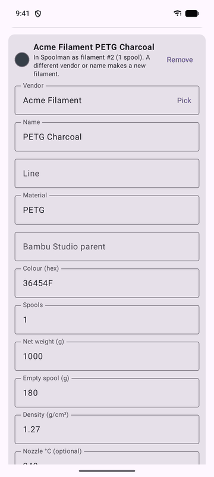

### B. From label photos (needs AI label reading)

This needs the server's `ai_intake` module and an Anthropic API key ([Install the server](install-server.md#change-what-is-installed)
says how). If **Add from label photos** isn't on the home screen, it's off, and the manual way above is the way.

1. Tap **Add from label photos**.
2. **Optional first:** to link the spool's NFC tag, hold the tag to the back of the phone (NFC must be on). The
   screen then shows `Tag …`; **Remove tag** undoes it. For one opened spool, also type its weight in **Weight on the
   scale, with spool (g)**; tick **Sealed** for a spool still in its bag.
3. Tap **Take photo** (allow the camera) for each label. Several photos of one spool are fine, up to 8.
   **Remove** under a photo deletes it. Type a hint in **Note for Claude (optional)** if it helps, for example
   `3 of the grey ones`.
4. Tap **Read labels**. Claude reads the photos; it can take up to a minute.
5. **Check the spools** shows what was read, one card per spool, with a badge saying whether the filament is
   already in Spoolman. If Claude was unsure it lists **Claude asks** questions at the top. **Correct anything
   that's wrong**: the card's fields are the same as in the table above, and **Remove** drops a spool. Photos and
   edits are kept if something fails.
6. Tap **Preview** (nothing is saved), then **Add n spools**, and check **Spools added**.

If the server says the photos were already added, the app asks before adding them again, because that can create
duplicates: check Spoolman first.

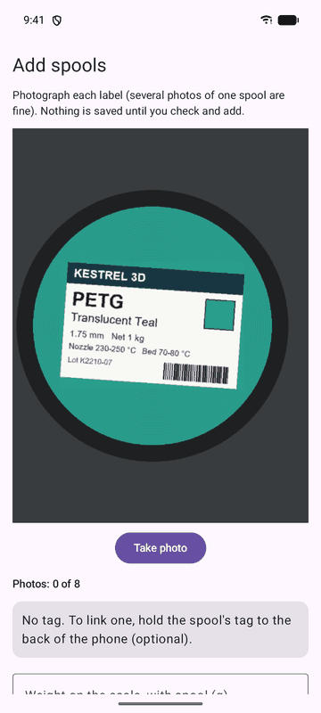 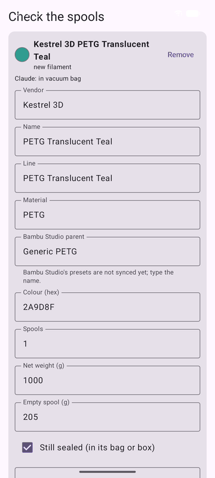

### Link an NFC tag, set the weight, and the rest

With the app open, tap a spool's NFC tag on the back of the phone.

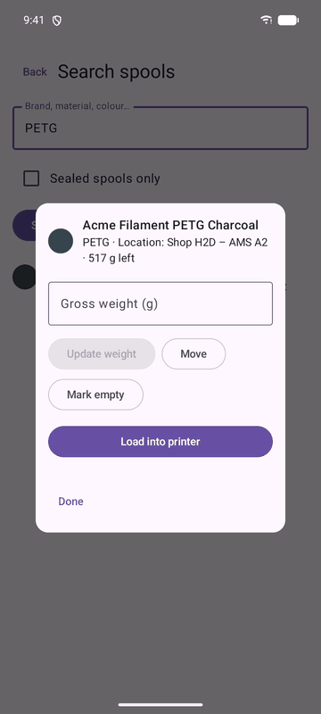

- **A tag already linked** opens the spool's card: type **Gross weight (g)** (the spool on a scale) and tap
  **Update weight**; the app shows `Remaining would change from … g to … g`, and **Confirm** saves it. **Move** changes
  its location, **Mark empty** records it as used up, **Load into printer** is described above.
- **A tag not linked yet** offers **Link to a sealed spool** (search for the spool by brand, name or colour, add a
  weight if you like, and **Confirm link**) or **Add as new**, which opens the add screen with this tag attached: label photos if your server reads labels,
  otherwise the **Add spool** form.
  If the tag is already used by another spool, the app says so and offers to move it here.
- **Search** on the home screen finds spools by brand, material or colour as you type (**Sealed spools only** narrows
  it) and opens the same card.
- **Add profile** is for a filament line the library doesn't have: fill in the fields marked `*` (vendor, product
  line, material) and any numbers from the maker's data sheet, and tap **Save**.
