# Using the app

How to pair the app with your Hub, set up a printer, and add spools by hand or from label photos. To install
the app first, see [Install the app](install-android-app.md); the Hub is
[Install the Hub](install-server.md).

The home screen has these buttons: **Add spools**, **Search**, **Printers** and **Settings**. A
dot at the top shows the connection: green **Connected**, yellow **Connecting…** or **Needs local network
access**, red **Can't reach the Hub** or **The Hub's certificate changed**, grey **Not paired**.
The dot follows the Hub while the app is open, within about 20 seconds. **Add from label photos** is only there
when the Label Reader's Cloud engine is turned on at the Hub. The app is light or dark as your phone is set. The small line at
the bottom shows the app's version and the Hub's.

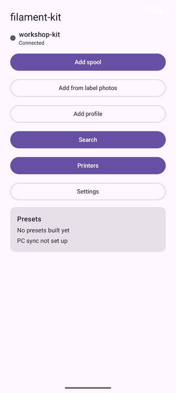

## 1. Pair the app with your Hub (once per phone)

1. On the Hub, in a Terminal:

   ```bash
   sudo filament-kit pair
   ```

   It prints a QR code, the Hub's certificate fingerprint and a 6-digit code, good for about 10 minutes. (The
   Hub page, `https://<computer name>.local:8710/setup`, can show a pairing code too.)
2. Open the app. On Android 17 and newer, tap **Allow** when it asks for **local network access** (it may call it
   **Nearby devices**). Without it the
   app can't find or reach your Hub. If you said no, the app shows **Allow** again, and **Open app settings**
   once Android stops asking.
3. Tap **Scan QR code**, allow the camera, and point the phone at the code in the Terminal. Done: the home screen
   opens with a green **Connected**. **Keep the white border around the QR code**: scan it from the whole
   Terminal window, and don't crop it or zoom in so far that the border is cut off.

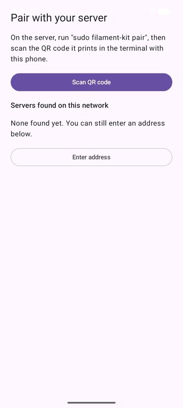

**No camera, or the code won't scan?** On **Pair with your Hub**:

1. Under **Hubs found on this network**, tap your Hub: it goes straight to the fingerprint check. If it isn't
   listed, tap **Enter the address instead** and type the computer's name with `.local` (for example `my-server.local`) or its IP
   address; leave **Port** at 8710, and tap **Connect**.
2. **Check the Hub's fingerprint** shows the Hub's address and its full fingerprint. Compare it with the
   fingerprint shown with the pairing code on the Hub (in the Terminal, or on the Hub page). If they match, tap
   **It matches**. If they differ, tap **It does not match** and stop.
3. Type the **6-digit code** from the Terminal.

**If it fails:** the code works once and expires; run `sudo filament-kit pair` again for a new one. Other
problems are in [Install the app](install-android-app.md#common-problems).

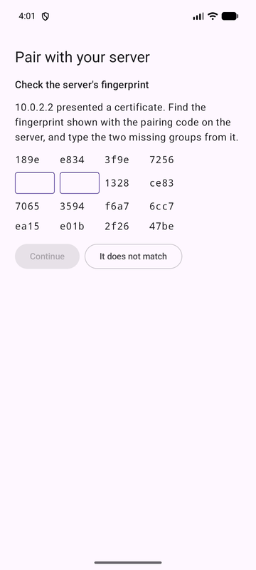

**Unpair or pair again.** On the phone: **Settings** shows the Hub's name, address and certificate fingerprint.
**Forget this Hub** (it asks to confirm; the spools stay on the Hub) unpairs this phone, and then you pair again
as above. **Pair again** does it in one step. On the Hub, `sudo filament-kit devices`
lists paired phones and `sudo filament-kit devices forget <device>` removes one; that phone is then asked to pair again. If the
app shows **The Hub's certificate has changed**, it lists the new fingerprint, which you can compare with the one shown with a pairing code on the Hub. Tap
**Trust the new certificate** to keep this pairing, or **Pair again** to pair with a new code. If you didn't reinstall or move the Hub, another
device may be answering at that address, and trusting it gives that device this phone's access. If the Hub no
longer knows this phone, for example after a reinstall with `--purge`, the app asks you to pair again.

**Check the fingerprint when pairing by address**, in **Settings**, is on by default. With it off, picking a Hub from
the list or typing its address goes straight to the 6-digit code and the app trusts the certificate the Hub presents. A scanned
QR code is checked either way, and a certificate that changes after pairing still asks you first.

**Licences and third-party software**, at the bottom of **Settings**, shows the app's licence (GPL-3.0-or-later) and the
third-party software list, and the full GPL text. It works offline.

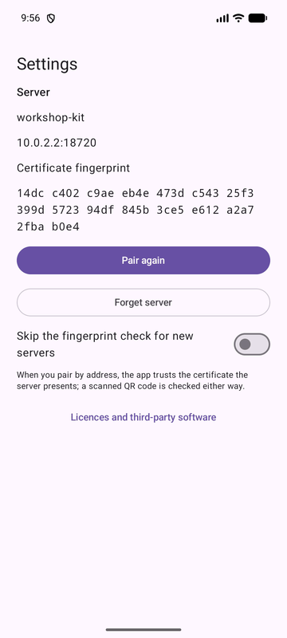 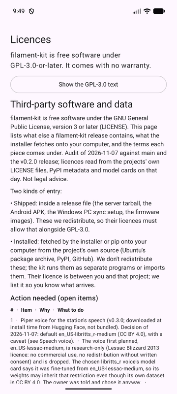

## 2. Set up a printer

You need a Bambu Lab printer on the same network as the Hub, switched on.

1. Open **Printers**. The Hub finds printers by itself; each shows its name, model and state. If the list is
   empty, check the printer is on and tap **Refresh**.
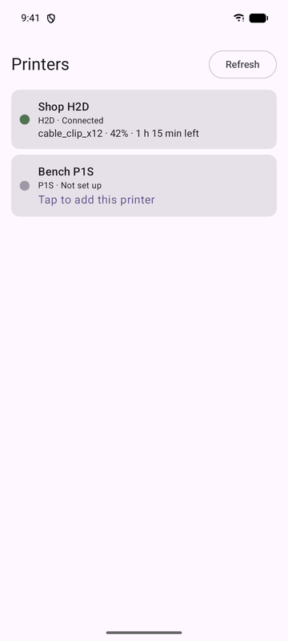 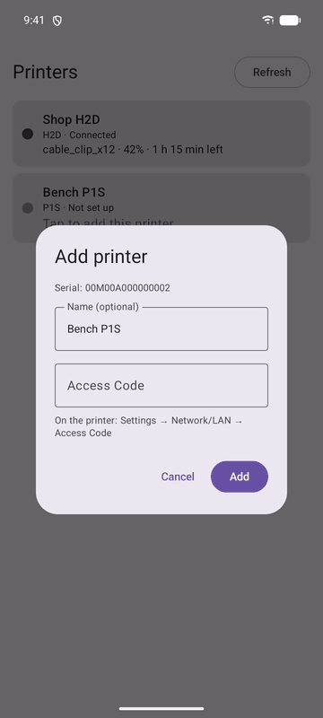

2. A printer marked **Tap to add this printer** is found but not set up. Tap it. The **Add printer** box shows its
   serial. Optionally give it a **Name**, type its **Access Code**, and tap **Add**. The code is on the printer:
   **Settings → Network/LAN → Access Code**.
3. The state turns to **Connected**, and tapping the printer opens its screen with live status, camera, the filament
   in each slot, pause/resume/stop and the chamber light. A loaded slot's colour sits inside a black ring, so white
   filament still shows; an empty slot is a dashed ring.

**If the state says something else:**

- **Wrong Access Code** (the row says **Tap to enter the Access Code again**): tap the printer, enter the code
  again.
- **Needs Developer Mode**: on the printer open **Settings → Network/LAN**, turn on **LAN Only mode** and then
  **Developer Mode**, and try again. Without it the printer refuses commands.
- **Offline**: check the printer is on and on the same network as the Hub.
- **Certificate changed**: the app explains it. If you reset the printer or replaced its mainboard, add it again
  with its Access Code; if not, check the printer's address first.
- The camera needs **LAN Mode Liveview** switched on in the same printer menu.

**Printer not in the list at all?** Add it from the Hub instead: `sudo filament-kit printer add`, with its name, IP address, serial number and Access Code. (A Hub in WSL or a virtual machine
behind NAT can't see printers; see [Running the Hub in WSL](install-server.md#running-the-server-in-wsl).)

**Change or remove a printer:** at the bottom of a printer's screen, **Printer settings** has **Rename**, **Change
address**, **Replace Access Code** (a Klipper printer: **Change API key**; empty clears it), **Trust a new
certificate** and **Remove printer**. A Bambu printer keeps its certificate when it moves, so its Access Code only
ever goes to the same printer; one that never connected needs its Access Code with the new address. **Trust a new
certificate** (only after you reset the printer or replaced its mainboard) asks for the Access Code. A Klipper printer
with an API key needs the key again when it moves. A new address, code or key reconnects and the screen says how that
went. A removed Bambu printer still on the network comes back in the list, not set up.

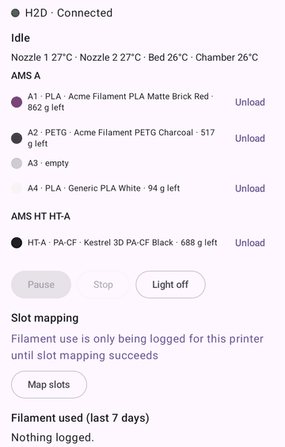

### Map slots: needed before filament use is taken off spools

Loading a spool into a slot works without it. Mapping teaches the Hub how the printer numbers its slots, so
that after a print the filament used is taken off the right spools. Until then, use is only logged on the
printer's screen under **Filament used (last 7 days)**.

Once a printer has been mapped, the Hub maps it again by itself when its AMS layout changes (you add or remove a
unit) and stays unchanged for 30 seconds, or after two prints in a row that disagreed with the map. It waits until
the printer is idle and tries up to 3 times, 10 minutes apart. The slot colours change briefly while it runs, without
you tapping anything. To switch this off, set `"auto_remap": false` in `/etc/filament-kit/config.json`.

1. Open the printer, make sure it's idle, and tap **Map slots**.
2. Read the box and tap **Map slots** again. The app briefly changes each slot's colour on the printer, one at a
   time, and runs a short job that doesn't heat or move anything; every slot is set back afterwards.
3. The **Slot mapping** section shows the Hub's outcome sentence and, under it, the next step. For example,
   **Mapped and confirmed: filament use comes off the spools.** means it worked. The other sentences are **Mapped, with
   something left to settle**, **Mapped, but the slot numbering is not confirmed: filament use is only logged**,
   **The last mapping failed.**, **The AMS layout changed since the map was made.** and **Recent prints disagreed with
   the map: filament use is only logged until it is mapped again.** Follow the next step under the sentence. A
   changed layout or disagreeing prints start a new mapping by themselves when the printer is idle, or tap
   **Map slots again**. A result from an earlier Hub run is labelled as old: it may be fixed by now. If the
   Hub says the printer could not tell its slot numbers, the filled button is **Map by loading filament**
   (below).

   With an older Hub (before v0.5.0) the app words the result itself: **Slots mapped (n)**,
   **Slots mapped: confirmed for the loaded slots**, **Slot numbering not confirmed**, **Slot mapping failed**,
   **Layout changed** and **Recent prints disagreed with the map**.

The **Map slots** button is greyed only while the printer is not connected or is printing, or while a mapping runs.
Until a mapping works, use is only logged, not taken off spools.

### Map by loading filament

If **Map slots** keeps failing, map the printer yourself. Under **Slot mapping**, tap **Map by loading filament**
(it is always there, and is the filled button when the Hub says the printer could not tell its slot numbers).
The printer must be connected and not printing. The app names one slot at a time:

1. It says which slot to load, for example "Load A2 to the nozzle, then wait." Load that slot on the printer's screen.
2. When the printer shows the load, the app asks whether that is the slot you loaded. Tap **Yes**, or
   **No, I loaded...** and pick the one you loaded. On a printer with two nozzles it also asks which nozzle, unless the
   printer says so itself. A printer that does not report what is loaded gets a list instead: pick the slot, and it is
   saved as you say.
3. **Skip** leaves a slot unmapped. **Stop** (then **Stop mapping**) ends it and keeps what you answered so far.

At the end the app asks whether to share the map in a printer report; **Yes, how do I share it?** says how, and
nothing is sent unless you choose to. The same flow is on the Hub page, in the web app and with
`sudo filament-kit printer map --by-loading <printer>`; see the
[user guide](user-guide.md#when-mapping-fails-map-by-loading-filament-v050).

### Collect a report

On a Bambu printer's screen, **Collect a report** asks the Hub for a short file about the printer and opens the
phone's share sheet, so you can save it or send it to an app. The button is filled, with the Hub's reason above it,
when a report would help (a printer filament-kit does not know yet, or a mapping that failed). The file holds no serial
number, address, name or account id. Read it before you attach it to an issue. More:
[user guide](user-guide.md#when-mapping-fails-map-by-loading-filament-v050).

### Load and unload a spool

- **Load:** open a spool (by tapping its tag, or via **Search**) and tap **Load into printer**. Pick the
  printer, pick the slot, and tap **Load**. This sets the slot on the printer to match the spool and moves the
  spool to that slot in your inventory.
- **Unload:** open the printer and tap **Unload** next to the slot. Only the inventory changes; the printer's own
  slot setting stays as it is.

## 3. Add spools

### A. By hand

1. On the home screen tap **Add spools**.
2. Under **Find a filament in Spoolman**, type a few words (for example `sunlu petg`). Tap a match to start from a
   filament you already have, or tap **New filament** for one that's new.
3. Fill in the card (fields marked in red need attention):

   | Field | What to enter |
   |---|---|
   | **Vendor** | The brand. Tap **Pick** for ones you already use; picking one fills in its empty-spool weight. |
   | **Name** | The product and colour, for example `PETG Grey`. |
   | **Line** | The product line (every colour of a line shares Slicer presets). |
   | **Material** | `PLA`, `PETG`, `PLA+`, ... |
   | **Bambu Studio parent** | Which Bambu preset the filament's preset starts from. Leave blank to let filament-kit choose, or tap **Pick**. |
   | **Colour (hex)** | Six hex digits, for example `808080`. |
   | **Spools** | How many identical spools. |
   | **Net weight (g)** | The filament weight on the label, for example 1000. |
   | **Empty spool (g)** | The weight of the empty spool. |
   | **Density (g/cm³)** | Leave blank and it's filled in from the material when known. |
   | **Nozzle °C**, **Bed °C** | Optional. |
   | **Still sealed** | Tick for a spool still in its bag or box. |
   | **Weight with spool (g)** | For an opened spool: its weight on a scale; blank means full. |
   | **Location** | Where it lives; blank means the Hub picks. |

4. Tap **Preview**. Nothing is saved yet: the app shows what would be added. If a field is still missing it says
   `Spool 1 still needs: ...`.
5. If the preview looks right, tap **Add 1 spool** (or the number). **Spools added** shows the new spool numbers; tap
   **Add more** or **Done**. Any change after a preview needs a new preview.

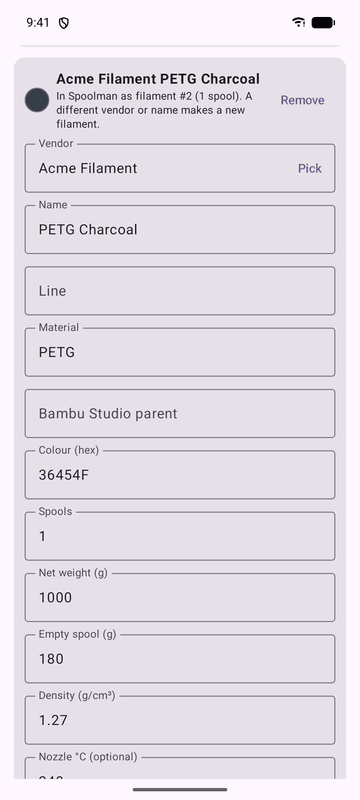

### B. From label photos (needs the Label Reader)

This needs the Hub's `ai_intake` Feature (Label Reader: Cloud (Claude)) and an Anthropic API key ([Install the Hub](install-server.md#change-what-is-installed)
says how). If **Add from label photos** isn't on the home screen, it's off, and the manual way above is the way.

1. Tap **Add from label photos**.
2. **Optional first:** to link the spool's NFC tag, hold the tag to the back of the phone (NFC must be on). The
   screen then shows `Tag …`; **Remove tag** undoes it. For one opened spool, also type its weight in **Weight with spool (g)**; tick **Sealed** for a spool still in its bag.
3. Tap **Take photo** (allow the camera) for each label. Several photos of one spool are fine, up to 8.
   **Remove** under a photo deletes it. Type a hint in **Note for the Label Reader (optional)** if it helps, for example
   `3 of the grey ones`.
4. Tap **Read labels**. The Hub's Label Reader reads the photos: Cloud (Claude), or On this Hub when the Hub
   has that engine turned on. It can take up to a minute.
5. **Check the spools** shows what was read, one card per spool, with a badge saying whether the filament is
   already in Spoolman. A line under the title says which engine answered; for On this Hub also its tier,
   how sure it was, and on each card the colour name and family and the least sure fields. If the reader was
   unsure it lists **Claude asks** (or **The local reader asks**) questions at the top. **Correct anything
   that's wrong**: the card's fields are the same as in the table above, and **Remove** drops a spool. Photos and
   edits are kept if something fails.
6. Tap **Preview** (nothing is saved), then **Add n spools**, and check **Spools added**.

If the Hub says the photos were already added, the app asks before adding them again, because that can create
duplicates: check Spoolman first.

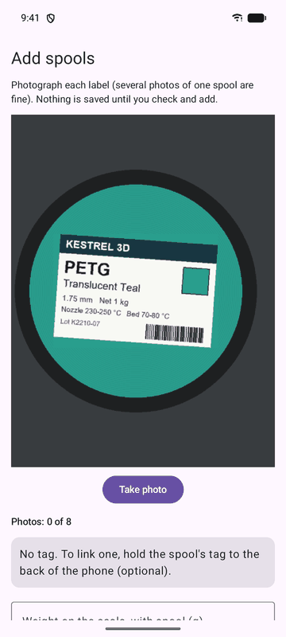 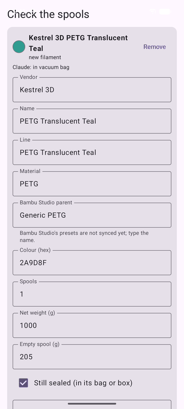

### Fix a spool that was added wrong: Recently added

**Recently added** on the home screen lists the last spools added (from the app, the web app, the Weigh Station
or the command line), newest first, with the label photo when there was one. Tap a record to see its photos (tap one
to enlarge it), the values saved and every change since. A spool read by On this Hub also shows what the reader
said then (colour name and family, how sure, least sure fields).

- **Ask the Label Reader to correct it** (needs the Label Reader): write what is wrong, for example `brand is Polymaker`, and tap **Ask the
  Label Reader**. It looks at the photos again with your note and shows the values it would change, old and new. Nothing changes
  until you tap **Accept**; **Discard** leaves the record as it was. The proposal says who read again (Cloud (Claude) or
  On this Hub, and how sure it was).
- **Edit by hand** changes any saved value directly, with no AI.
- **Undo** takes back the newest change, one at a time.

A correction never edits a filament other spools also use: the spool is moved to the right filament (found or
created), and its tag, location, opened state and used weight stay. A filament left with no spools is named, not
deleted. How many records the Hub keeps is a setting on the Hub page (**Records kept**, 20 by default).

### Slicer presets: build, accept updates, restore deleted ones

The **Slicer presets** card on the home screen shows the last build and where your PC stands. **Build now** asks for a
build (shown while no Slicer Sync is set up). **Review n updates** (or **Updates**) lists each preset already in your
slicers that a newer build would change, with what changes; **Accept n updates** accepts exactly that list, and Slicer Sync
on your PC writes them at its next sync. If a newer build came meanwhile, nothing is accepted and the new list is shown.
**Bring back deleted presets** has the next build bring back the ones deleted in Bambu Studio.

### Link an NFC tag, set the weight, and the rest

With the app open, tap a spool's NFC tag on the back of the phone.

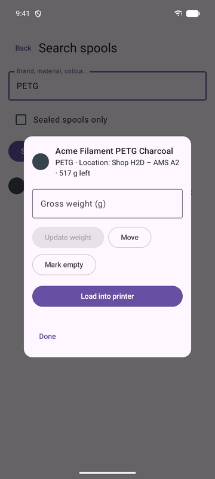

- **A tag already linked** opens the spool's card: type **Weight with spool (g)** (the spool on a scale) and tap
  **Update weight**; the app shows `Remaining would change from … g to … g`, and **Confirm** saves it. **Move** changes
  its location, **Mark empty** records it as used up, **Load into printer** is described above.
- **A tag not linked yet** offers **Link to a sealed spool** (search for the spool by brand, name or colour, add a
  weight if you like, and **Confirm link**) or **Add as new**, which opens the add screen with this tag attached: label photos if your Hub reads labels,
  otherwise the **Add spools** form.
  If the tag is already used by another spool, the app says so and offers to move it here.
- **Search** on the home screen finds spools by brand, material or colour as you type (**Sealed spools only** narrows
  it) and opens the same card.
- **Add your own entry** (Filament Catalog, on the Hub page) is for a filament line the Catalog doesn't have: fill in the fields marked `*` (vendor, product
  line, material) and any numbers from the maker's data sheet, and tap **Save**.
