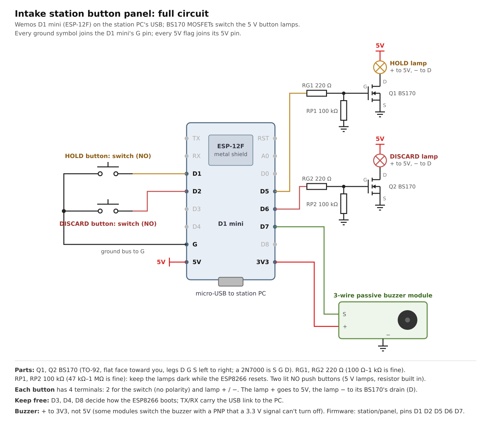

> In filament-kit the station is installed as the `station` module (`filament-kit modules`), runs as
> `filament-kit-station.service` from `filament_kit.station`, and this firmware lives in `station/panel/` of the
> filament-kit repo. Paths and service names below are from filament-ops.

# Intake station button panel

Optional front panel for the intake station: a Wemos D1 mini (ESP-12F) on the station PC's USB, a 3-wire passive
buzzer, and two illuminated normally-open push buttons, **Hold** and **Discard**. The D1 mini is a thin I/O board;
`intake_station.py` owns all the logic, so behaviour changes never need a reflash.



## Wiring

| Part | D1 mini pin | ESP8266 GPIO |
|---|---|---|
| Hold switch (either terminal; other to G) | D1 | 5 |
| Discard switch (either terminal; other to G) | D2 | 4 |
| Hold lamp: BS170 Q1 gate via 220 Ω, 100 kΩ gate to G | D5 | 14 |
| Discard lamp: BS170 Q2 gate via 220 Ω, 100 kΩ gate to G | D6 | 12 |
| Buzzer S (signal) | D7 | 13 |
| Buzzer + / − | 3V3 / G | |
| Lamp + / lamp − | 5V / MOSFET drain (D); source (S) to G | |

Leave D3 (GPIO0), D4 (GPIO2) and D8 (GPIO15) free: their level at power-on decides whether the ESP8266 boots or
waits to be flashed. TX/RX (GPIO1/3) carry the USB serial link to the PC. The lamps (5 V type, resistor built in)
are switched by BS170 N-MOSFETs because a GPIO pin gives 3.3 V at about 12 mA at most; the 100 kΩ pull-downs keep
them dark while the ESP8266 resets. BS170 legs, flat face toward you: D G S (the look-alike 2N7000 is S G D).

## Behaviour

| Event | Hold lamp | Discard lamp | Buzzer |
|---|---|---|---|
| Idle | off | off | |
| Tag scanned | on | on | one high beep |
| A stable weight on the scale (no scan) | off | on | |
| Hold pressed, scan + weight there | flashing | on | two short high beeps |
| Hold pressed again | on (or off once the scan is over 5 min old) | on | one mid beep |
| Hold pressed with no scan or no weight | unchanged | unchanged | one low buzz |
| Discard pressed | off | three fast blinks, then off | one low beep |

- A held weight keeps its scan current for the phone app until Discard or the next scan; without Hold, a scan and
  a weight count for 5 minutes (`STATION_ACTIVE`, matching the VM's `TAG_FRESH`). `/state` marks held entries
  with `"held": true`, and the VM's intake app accepts them at any age.
- After Discard, a spool still on the scale is ignored until the pan is emptied (or the scale switches itself off),
  so the Discard lamp doesn't come straight back on.
- A new scan replaces the old one and drops any held weight.
- Without the panel, a scan beeps through the PC's audio output instead (see `intake_station.py`).

## Serial protocol (115200 baud, one line each)

| Direction | Line | Meaning |
|---|---|---|
| PC → panel | `?` | answer with HELLO |
| PC → panel | `L <hold> <discard>` | lamp modes: 0 off, 1 on, 2 flash, 3 three fast blinks then off |
| PC → panel | `B <hz> <ms> [count]` | beep(s) |
| panel → PC | `HELLO intake-panel <version>` | at boot and after `?` |
| panel → PC | `P H` / `P D` | Hold / Discard pressed |

The PC resends `L` every second; after 5 s without one (service stopped) the panel turns its lamps off.

The panel and the PN532 reader both use CH340 USB serial chips with no serial number, so their `ttyUSB` numbers can
swap between boots. The service finds the panel by its HELLO and gives nfcpy the other port (`NFC_DEVICE=auto`).

## Build and flash

PlatformIO on the desktop (`py -3 -m platformio`). Plug the D1 mini into the desktop, then:

```
cd <local path>\filament-ops\station\panel
py -3 -m platformio run -t upload
```

PlatformIO picks the COM port itself (add `--upload-port COMn` if there are several). Then move the board to the
station's USB and restart the service (`sudo systemctl restart intake-station`). The journal shows
`button panel on /dev/ttyUSBn`.
